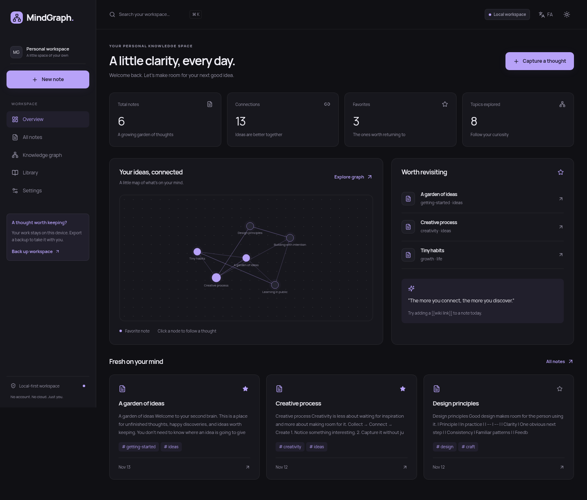

<div align="center">

# MindGraph

**A quiet home for connected thinking.**

A local-first personal knowledge base with Markdown, wiki links, and an interactive knowledge graph.

[Features](#features) · [Getting started](#getting-started) · [Architecture](docs/ARCHITECTURE.md) · [فارسی](docs/README.fa.md)

  



</div>

## Features

- A full product landing page and five dedicated dashboard pages.
- Markdown editor with write, preview, and split views; GFM tables, task lists, and code blocks.
- Connect ideas with `[[Note title]]`, navigate backlinks, and create notes from unresolved links.
- Interactive SVG knowledge graph with zoom, keyboard navigation, and topic filtering.
- Instant content/tag search, favorites, topic browsing, and Markdown downloads.
- Versioned localStorage, Zod-validated backups, import/export, and cross-tab updates.
- English and Persian, RTL layout, bundled Manrope/Vazirmatn fonts, light/dark themes.
- Responsive navigation, accessible dialogs, visible focus states, reduced-motion support.

## Getting started

Requires **Node.js 24** and npm. No API keys, database, or environment variables.

```bash
npm ci
npm run dev
```

Open the development server on port 3000. To run both projects together, start MindGraph with `npm run dev -- --port 3000`.

```bash
npm run build
npm start
```

Any host supporting Next.js 16 can run the production build. No deployment has been provisioned.

## Validation

```bash
npm run lint
npm run typecheck
npm test
npx playwright install chromium   # once, if a system Chromium is unavailable
npm run test:e2e
```

The browser suite covers localization and theme persistence, mobile navigation and overflow, JSON backup recovery, corrupt-storage handling, and note CRUD, wiki links, backlinks, graph navigation, and search. It needs no external API credentials. Playwright starts a development server if one is not already running. CI runs the same checks plus a production build.

## Data ownership & limits

Workspace data lives in this browser and origin; a different port, hostname, browser, or device has a separate workspace. There is no cloud sync or account system. Browser storage is not a durable backup. Export JSON regularly, especially before clearing site data. Imports **replace** the current workspace after confirmation. Invalid stored data is preserved until an explicit user edit or restore; storage failures are reported in the UI.

Notes render without raw HTML execution. Graphs show at most 80 notes at a time; the library retains all notes. Renaming a note does not rewrite incoming wiki links, which match titles case-insensitively. Use unique titles to avoid ambiguity.

TanStack Query is deliberately omitted: there is no remote server state to cache. React manages UI state and a validated local store owns persistence.

## GitHub Projects

The tracked [project plan](.github/project-plan.json) contains completed v1 milestones and an optional backlog. A real GitHub Project can be populated and linked using:

```bash
node scripts/setup-github-project.mjs --dry-run
node scripts/setup-github-project.mjs
```

This uses GitHub CLI authentication with Projects access and `api.github.com` connectivity. It reuses a matching project and task titles to avoid duplicates. A checked-in plan is **not** proof that a GitHub Project has been created. The script fails before writes when API access is unavailable. Check the printed project URL after a successful run.

## Screenshots

[Landing](docs/screenshots/landing-dark.png) · [Workspace](docs/screenshots/dashboard-dark.png) · [Persian / light](docs/screenshots/dashboard-fa-light.png) · [Mobile](docs/screenshots/mobile.png)

## License

[MIT](LICENSE) © 2026 Mohammad / mmdbazooka
